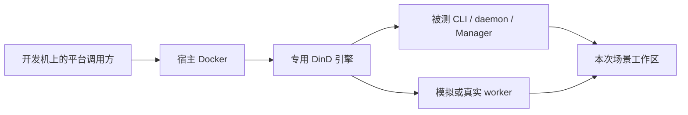

# 本地可销毁测试平台

在 Linux、Dev Container 和 Linux CI 中运行独立 Docker 引擎。模拟与真实 harness 共用同一套轮次生命周期 `run / status / destroy`、工作区复制、结果采集与留证；调用方显式给出镜像、命令和环境变量。

## 环境与快速开始

需要 Node.js 24、仓库锁定的 pnpm，以及能够启动特权容器的宿主 Docker。使用仓库的 Dev Container 时，重建并重新打开开发容器，使 `.devcontainer/devcontainer.json` 中的 Docker outside of Docker feature 生效；先确认 `docker info` 成功，再运行：

```sh
pnpm install --frozen-lockfile
pnpm test:platform run \
  --state-dir /abs/state \
  --evidence-dir /abs/evidence \
  --image node:24-bookworm-slim \
  -- node -e 'console.log("ready")'
pnpm test:platform status --state-dir /abs/state
pnpm test:platform destroy --state-dir /abs/state
```

没有独立的准备命令：`run` 在状态目录没有平台时自行创建，创建步骤不对外暴露。`--evidence-dir` 是必填的外部证据目录，且不得与状态目录相互包含。平台是特权 DinD 容器，配两个命名卷和一个网络；外层仅监听 Unix socket，不发布 TCP 端口，宿主 Docker socket 既不进入 DinD 也不进入被测容器。引导镜像固定到摘要。



## 同一接口承载两种运行方式

`run` 不选择 harness、模型、推理强度或提示词。镜像、命令及其参数由调用方提供。缺少真实镜像、程序或凭据时按实际失败返回，平台不自动改用模拟、也不自动重试。

```sh
# candidate-input 只放本次需要的发布包、场景脚本和输入文件。
pnpm test:platform run \
  --state-dir /abs/state \
  --evidence-dir /abs/evidence \
  --image registry.example/your-harness-runtime:version \
  --source ./candidate-input \
  --env VENDOR_API_KEY \
  --timeout-ms 300000 \
  -- node scenario.ts
```

上例的镜像、环境变量名与场景脚本均为调用方替换项。需要真实 harness 时，用安装好该 harness 的镜像和相应场景；模拟时，使用可控 adapter fixture。模拟结论只覆盖实际执行的产品路径，真实厂商行为仍须独立实测。

每次运行获得独立工作区。只复制显式 `--source`，省略时工作区为空；不要把整个仓库、`.scratch`、`node_modules` 或旧 worktree 作为输入。文件进入平台卷，不依赖宿主与开发容器的源码路径相同。

`--env NAME` 仅转发调用方指定的现有变量，可重复给出。环境值通过权限为 `0600` 的临时 env 文件传给内层引擎，不进入被测容器的命令行，也不记入证据；清单只保存变量名。当前不接受 CR、LF、NUL。厂商输出可能包含输入内容，原始日志应按场景自身的数据要求管理。

Manager 或其他场景需要创建子容器时，显式增加 `--docker-access`，并在其运行镜像内安装 Docker CLI。暴露的是本平台内层引擎的 socket。工作区在内层引擎与被测容器中使用相同绝对路径，因此 Manager 可以把 `$PWD` 绑定进子容器。

## 一轮的生命周期

库 API `runRound` 接受多个场景并共用同一个内层引擎，按声明顺序执行；CLI 的 `run` 是单场景入口。一轮的次序固定：准备或显式复用平台 → 逐场景执行 → 每个场景结束即回收它新增的主容器、子容器、自定义网络、卷与工作区 → 导出证据 → 默认完整销毁。

| 命令      | 行为                                                                           |
| --------- | ------------------------------------------------------------------------------ |
| `run`     | 准备或复用平台、执行场景、留证，默认完整销毁；`--reuse` 保留已验证健康的平台。 |
| `status`  | 报告清单记录的阶段、外层容器与内层引擎的实际状态、未收尾场景与锁持有者。       |
| `destroy` | 按清单与归属标签从平台外回收资源；失败保留清单，修复后重试相同命令。           |

`--reuse` 只在平台健康且清洁时被接受：阶段必须是 `retained`、引导摘要一致、上一轮场景全部完成且无残留，否则拒绝复用而不是接管。跨轮次保留的是内层镜像与引擎缓存；每一个场景的主容器、子容器、网络、卷和工作区都在该场景收尾时回收，边界不收敛就立即停止后续场景并销毁平台。

被超时或取消中断的场景，其创建请求可能已进入内层 daemon 并在本轮回收扑空之后才落地。平台通过内层清单确认该场景主容器实际落地，并在有界窗口内继续回收和复查。未观察到落地或仍有资源残留时如实报告清理不完整并销毁平台；删除命令成功本身不能证明创建请求已结束。

## 结果与退出码

输出由 `@ykdz/cli-contract` 按声明的契约生成：成功结果是一行 JSON 写到 stdout，失败结果是一行 JSON 写到 stderr，载荷即 `roundResultSchema`，包含轮次标识、平台标识、每个场景的真实进程结果、验证项状态、证据清单与回收事实。

`run` 的退出码只取声明值：全部必需项通过为 `0`；场景失败或未收尾为 `1`；超时为 `124`；SIGINT／SIGTERM 分别为 `130`／`143`。被测命令自己的退出码原样保留在场景记录里（例如命令 `exit 7` 时平台仍以 `1` 退出，但 `scenarios[].exitCode` 是 `7`）。验证项为 `not_run` 或 `incomplete` 时不会被当作通过。

## 证据与恢复

默认销毁之前，本轮事实与完整日志先导出到 `--evidence-dir`：`rounds/<roundId>/round.json`（平台与场景身份、待回收资源名称）、`scenarios/<id>/{stdout.log,stderr.log,collected}`、内层 daemon 日志，以及回收完成后追加的 `reclamation.jsonl`。同一轮次重复导出保留首次的唯一证据并追加新的观察记录，成功回收不会抹掉已导出的证据；留证失败与回收失败各自保留原始错误。

状态目录 `<state>/platform.json` 在每次 Docker 变更之前写入，资源名唯一并由归属标签标识。同名资源属于其他平台时拒绝接管；部分创建失败时按清单重试回收；内层引擎失联时仍从外层回收。运行前已存在的引导镜像归调用方所有并保留，本轮新拉取的镜像才尝试删除。平台不使用宿主级 `prune`。

控制程序被 `SIGKILL`、场景挂起或内层 daemon 停止后，仍可用同一状态目录执行 `status` 与 `destroy`：`status` 会如实报告未收尾场景与遗留锁的持有者，`destroy` 依据清单补齐留证并回收。**清理完成前不要手动删除状态目录**，否则会丢失资源清单。宿主 Docker 本身不可达时需先恢复宿主 Docker。

## 开发检查与实机验收

```sh
# 无 Docker 的短反馈：生命周期行为、类型、格式、lint 随仓库门禁运行。
pnpm --filter @reins/test-platform test
pnpm --filter @reins/test-platform typecheck

# 完整验收：自动准备正式候选和独立消费者锁，再串行执行真实 Docker 用例。
pnpm exec turbo run test:docker --filter=@reins/test-platform

# 全仓门禁也包含同一条 Docker 依赖链。
pnpm check
```

Docker 验收显式失败于缺少 Docker，不静默跳过，并只用归属标签查询自己创建的资源。场景镜像可用 `REINS_TEST_PLATFORM_IMAGE` 覆盖，默认 `alpine:3.20`。

Turbo 的 Docker 任务继承调用方已有的 `DOCKER_*`、`SSH_AUTH_SOCK` 与 Dev Container 凭据助手所需的 `REMOTE_CONTAINERS_IPC`，使宿主连接和凭据取得方式与直接运行一致。

Linux 单元测试使用 `/dev/shm` 存放可丢弃临时状态，避免宿主磁盘的同步写入延迟导致超时；仍执行真实文件读写与 fsync。真实 Docker 验收的状态和证据使用 `.artifacts`，包含进程强制退出后的恢复验证。

验收覆盖：默认销毁的一轮先留证再回收且宿主无残留、显式复用多轮共用同一内层引擎并逐场景清理子资源、真实 CLI 的 `exit 7`／超时／SIGINT／SIGTERM 固定码、`SIGKILL` 打断创建或场景后用 `status` 与 `destroy` 恢复、以及内层停止后的外层回收。用例各自使用 `.artifacts/s1-docker/<用例>/state`，结束时按清单自动销毁；异常退出后手动执行：

```sh
pnpm test:platform destroy --state-dir /abs/state --evidence-dir /abs/evidence
```

CI 使用同一 Turbo 依赖图执行 Docker 验收，并在失败时上传已形成的外部证据。缺少真实厂商服务不妨碍模拟验收；真实厂商的验收结果必须说明实际镜像、候选和场景，不能沿用模拟结论。

正式消费者用例使用 `.artifacts/acceptance-input` 中已校验的候选、pnpm 11.22.0 消费者锁和组内夹具，经真实 CLI、daemon、Unix socket 与可控 adapter 完成两会话及后续回合。组内文件摘要在安装前后核对，SDK 正常解析位置和额外运行时身份单独留证。完整产品日志写入场景工作区，再由平台导出到 `.artifacts/acceptance-docker/evidence`；输入、运行状态与证据目录彼此分开。
